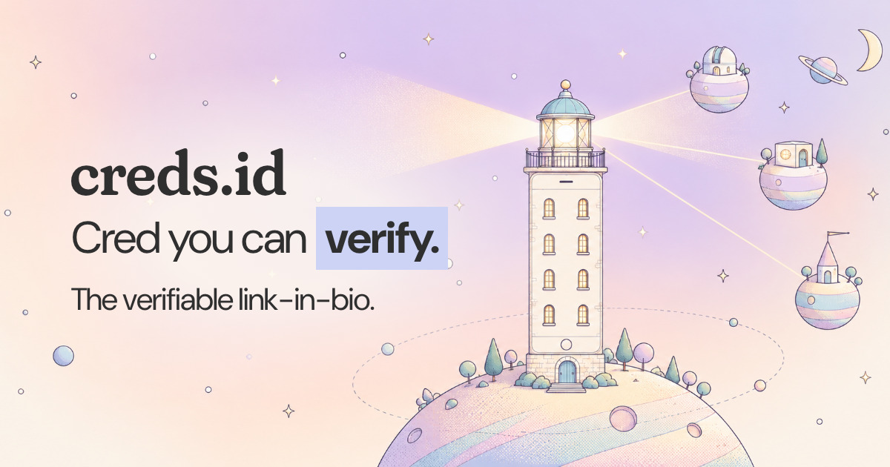

### We're Solid(ar)ity. We build **[creds.id](https://creds.id)** — the verifiable link-in-bio.

## Anyone can make a link page. creds proves it's yours.

Claim `creds.id/@you`, add your links, share one page. The whole page is **signed by your own key** and **checked in the visitor's browser** — no install, no account — so anyone can confirm on the spot that the page and the accounts on it really belong to you.

- 🔏 **Signed end to end** — change one character and the signature no longer matches.
- 🔗 **Bound both ways** — your `@name` points to your account and the account points back. Only then does a link get a check; one-sided claims are marked *Declared*, never "verified".
- 🧪 **zkTLS social proofs** — prove you control an X or LinkedIn account from a real TLS session, without handing anyone your login. *(landing in creds 2.0)*
- 🛂 **Passport ZK** — tap your e-passport's NFC chip and prove *"over 18"* or *"citizen of …"* with a zero-knowledge proof. Nothing else leaves the phone.
- 🔑 **Passkeys, no passwords** — sign up with Apple or Google; your root key syncs between app and web as ciphertext the server can't open.
- ⚡ **Nostr-native** — every page comes with a `name@creds.id` NIP-05 identity.

> **Company-dies-still-works.** Your identity is a key on your device and your page verifies itself. If we vanished tomorrow, every creds page would still check out.

## Repositories

| | |
| --- | --- |
| 📱 **[creds-app](https://github.com/p2p-solidarity/creds-app)** | The iOS & Android app — verified profile, digital business card, NFC passport ZK, Nostr & Bluesky identity. Expo + React Native + Nitro Modules. |
| 🛰️ **[creds-api](https://github.com/p2p-solidarity/creds-api)** | The small, mostly-blind backend on Cloudflare Workers — passkey-wrapped vault sync, `name@creds.id` directory, encrypted inbox. Holds ciphertext, not keys. |
| 🛂 **[passport-noir](https://github.com/p2p-solidarity/passport-noir)** | Noir circuits for ICAO 9303 e-passports — RSA-SHA256 + data-group hash chain, selective disclosure, OpenAC linking. Swift Package with mopro bindings. |
| 🗺️ **[unmapped](https://github.com/p2p-solidarity/unmapped)** | From the lab: an endless, local-first open world an LLM writes as you explore, with P2P continents over WebRTC. |

Earlier work — Solid(ar)ity 1.x, WAMO ID, DID/DIDComm demos — lives on as `legacy-*` repos and at [docs.solidarity.gg](https://docs.solidarity.gg).

## Built with

**[creds.id](https://creds.id)** · **[solidarity.gg](https://solidarity.gg)** · gm@solidarity.gg

